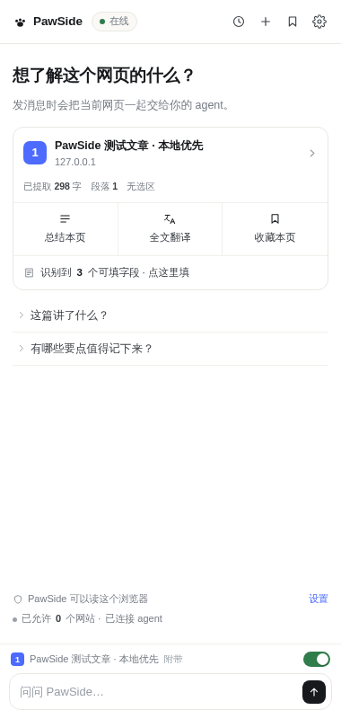
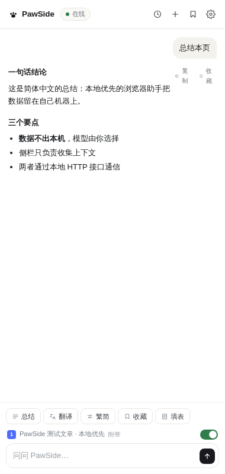
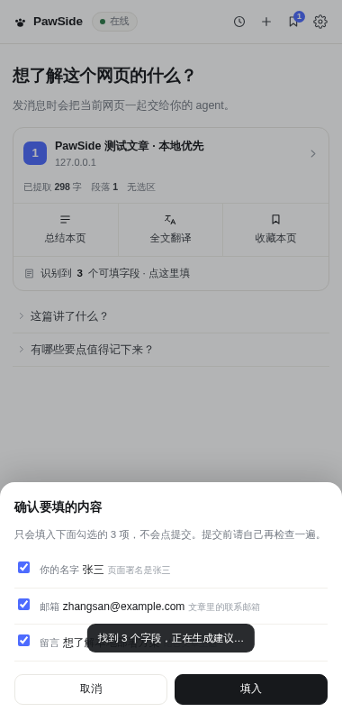
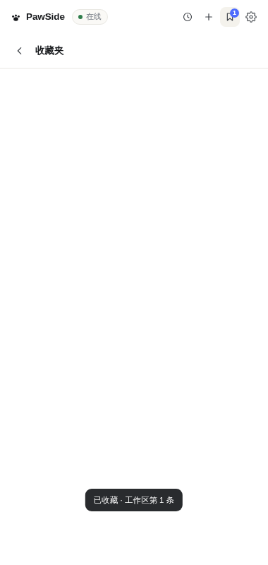
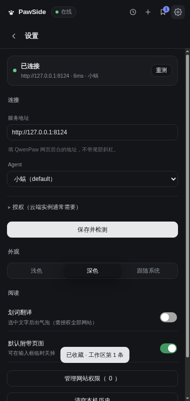

# 🐾 PawSide

**在浏览器侧栏里，跟你自己的 QwenPaw 聊「眼前这一页」。**

总结、全文翻译、填表、收藏到工作区 —— 不用复制粘贴，不用在窗口之间来回跳。

[🎬 在线演示](https://hxx0611.github.io/pawside/) ·
[⬇️ 下载 v0.4.1](https://github.com/hxx0611/pawside/releases/latest) ·
[🔧 怎么装](#-怎么装) ·
[🧩 能干什么](#-能干什么) ·
[🔌 连不上](#-连不上怎么办)

---

## 一句话说清它是什么

你在读一篇长文章，想问「这玩意儿到底在讲啥」。
平时你得：选中全文 → 复制 → 切到 QwenPaw → 粘贴 → 问 → 再切回来。

装了 PawSide，你点侧栏里的「总结本页」，等几秒，答案就在旁边。

它只是把你眼前这一页，递给你**已经在跑的那个 QwenPaw**（本机 `127.0.0.1:8088` 或你自己的云端实例）。

所以前提只有一个：**你得先有个 QwenPaw。**

---

## 🎬 长什么样

 
打开就是这个样子 —— 先告诉你这一页能干什么，再让你决定

| 对话 | 填表 |
|---|---|
|  |  |
| 流式回答 + 复制 / 收藏 / 追问 | 逐项确认，最后一步你点 |

| 收藏夹 | 设置（深色） |
|---|---|
|  |  |
| 收藏直接落到你的 QwenPaw 工作区 | 三步连接向导，报错翻成人话 |

想自己点两下？👉 **[在线演示](https://hxx0611.github.io/pawside/)** —— 界面是真的，数据是编的，随便点不会炸。

---

## 🧩 能干什么

**📄 总结本页**
不是「把正文丢给模型」这么简单。它会先给你看提取结果（多少字、多少段、有没有选中），
你确认了才发。页面是登录墙、是 PDF、是纯 JS 渲染的空壳 —— 它会在卡片上直接告诉你，而不是编一段答案。

**🌐 全文翻译**
长文整篇翻，保留段落。翻完可以一键切简繁，译文跟着换。

**✍️ 填表（这个我比较得意）**
扫描页面上的输入框 → 让 agent 给你一份「字段 / 建议值 / 依据」的表 → **你逐项勾，点确认才写入**。
它不会替你点提交，也不会碰密码框。
理由很简单：填错一个手机号，比多按一次提交烦人多了。

**🔖 收藏 → 直接进工作区**
点一下，这条内容就写进你 QwenPaw 工作区的 `pawside-clips.md`（带页面标题和链接）。
不是存在扩展的黑盒里 —— 是你的 agent 下次能直接读到的东西。删掉也会同步改写。

**🔁 简繁一键换**
内置 OpenCC，本地跑，不联网、不调模型、不花钱。

**🕘 历史在本地**
对话存 `chrome.storage.local`，最多 40 条。不上传、不同步、不统计。

**⬆️ 有新版本会告诉你一声**
设置页一天问一次 GitHub，发现新版就在下面挂一行，齿轮上也点个小点 —— 不然你根本不会打开设置页。
点「去更新」跳 Release，你自己下新的 ZIP 覆盖掉。
它**不会**自己下载替换：手动加载的扩展没这个权限，说「自动更新」是骗人的。

---

## 🔧 怎么装

1. **确认 QwenPaw 在跑**
   浏览器打开 `http://127.0.0.1:8088` 能出界面就行。云端实例也可以，后面填地址。

2. **下载 ZIP 并解压**
   到 [Releases](https://github.com/hxx0611/pawside/releases/latest) 下 `pawside-0.4.1.zip`，解压到一个**你不会再动它**的目录。

3. **加载**
   Chrome 地址栏进 `chrome://extensions` → 右上角打开「开发者模式」→「加载已解压的扩展程序」→
   选中**直接含 `manifest.json` 的那一层**（不是它的父目录，这是最常见的错）。

4. **连上**
   点工具栏的爪子图标（没看到就点拼图 🧩 把它固定出来）→ 侧栏打开 → 点右上齿轮 →
   填服务地址 → 点「测试连接」。
   - **本机**：`http://127.0.0.1:8088`，一般直接就能连
   - **云端 / 托管实例**：填你的公网地址，粘贴令牌（没有令牌就在向导里用账号密码换一个）

状态灯变绿就完事了。第一次点「总结本页」会问你要这个网站的读权限 —— 点允许。

> 要求：Chrome / Edge 116 以上（要用 `chrome.sidePanel`）。Firefox 不行，别试了。

---

## 🔌 连不上怎么办

| 你看到的 | 真正的原因 | 怎么办 |
|---|---|---|
| 灯是灰的，提示连不上 | 地址打错，或者 QwenPaw 没起 | 浏览器直接开那个地址试试，能开再回来 |
| 灯绿了，但一发消息就失败 | 托管实例的网关不回跨站 POST | 0.3.0 之后会自动改用「在你实例标签页里代发」，保持那个标签页开着就行 |
| 提示要令牌 / 401 | 开了 Web 鉴权但没填令牌 | 设置里「用账号密码换令牌」，密码不落盘 |
| 「需要读取权限」 | 这个网站你还没允许 | 点权限卡片上的「允许读取」，或在权限页手动加 |
| 面板一片空白 | 加载了错的目录 | 重新加载，选含 `manifest.json` 那一层 |

更细的排查（每一条错误的原始报文、根因）在 [TECH.md](TECH.md)。

---

## 🔒 它到底能看到什么

说清楚，别信「我们很重视隐私」这种话：

- **只看你点了「允许」的网站。** 用的是 `optional_host_permissions`，默认一个都没有。
- **读的时机是「你点动作的那一刻」。** 没有后台常驻抓取，没有轮询。
- **内容发给你自己的 agent，不经过任何第三方。** 这项目没有服务器 —— 想加也没地方加。
- **收藏写进你自己的 QwenPaw 工作区**，历史留在你的浏览器本地。
- **没有埋点、没有统计、没有账号体系。** 你也可以直接读源码，一共几千行，一眼能看完。

---

## 🙏 致谢

- [QwenPaw](https://github.com/agentscope-ai/QwenPaw) —— 干活的那一半。Apache-2.0。
- [xiaoxia.app](https://xiaoxia.app) —— 侧栏形态的参考对象，界面这件事上偷了不少师。
- [OpenCC-js](https://github.com/nk2028/opencc-js) —— 简繁转换。MIT。

本项目 MIT。见 [LICENSE](LICENSE)。
